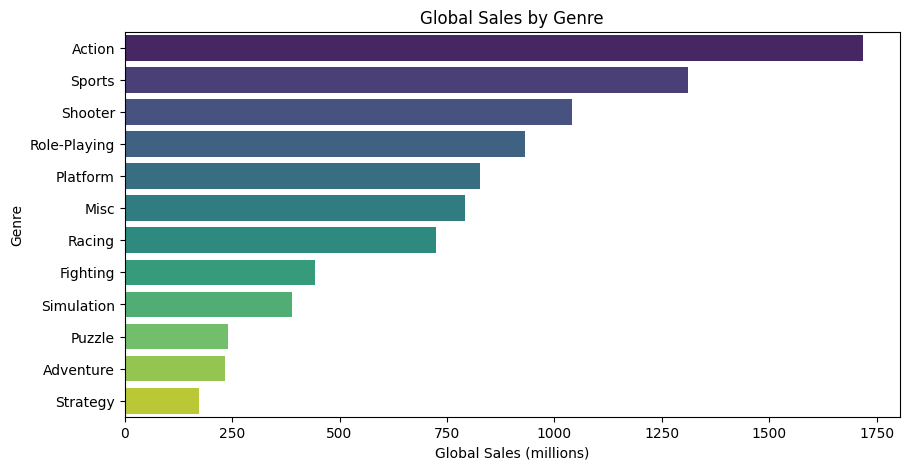
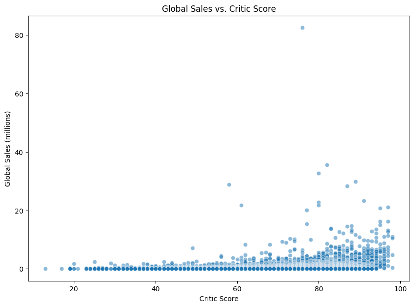

# Predicting Video Game Global Sales

**Can we forecast how well a video game will sell before it launches?** Game development is high-cost and high-risk, so publishers want early signals about which projects to greenlight and which platforms to target. This project builds and compares regression models that predict a game's global unit sales from characteristics known before release: platform, genre, publisher, developer, release year, ESRB rating, and review scores.

📓 [Notebook](video_game_sales_model.ipynb) · 📄 [Paper](video_game_sales_writeup.pdf)

---

## Key Findings

- **Random Forest was the best model, but no model predicted sales well.** All three explained only about 19–20% of the variation in global sales.
- **Random Forest made noticeably smaller typical errors.** Its mean absolute error was about 18% lower than linear regression's (0.46M vs. 0.56M units), suggesting non-linear patterns linear models miss.
- **A handful of blockbusters dominate sales.** A few titles sell 20–80M units while most sell well under 1M, which makes the target hard to model with standard regression.
- **Genre and critic scores matter.** Action, Sports, and Shooter games lead total sales, and the biggest sellers almost all have critic scores above 70.

| Model | R² | RMSE (M units) | MAE (M units) |
|-------|----|----------------|---------------|
| Linear Regression | 0.186 | 1.85 | 0.56 |
| Linear Regression + MinMax Scaler | 0.186 | 1.85 | 0.56 |
| **Random Forest (tuned)** | **0.200** | **1.84** | **0.46** |

## Data

- **Source:** [Video Game Sales with Ratings, Kaggle](https://www.kaggle.com/datasets/rush4ratio/video-game-sales-with-ratings)
- **Size:** 16,719 games released 1980–2016, 16 columns; 16,450 rows after cleaning
- **Target:** Global sales (millions of units)
- **Note:** Regional sales columns (North America, Europe, Japan, Other) were removed because they add up to the target and would leak the answer into the model.

## Approach

1. **Exploratory analysis:** Distributions of critic and user scores, and global sales by year, publisher, genre, and platform.
2. **Data preparation:**
   - Removed rows missing release year or sales, and converted user scores to numeric
   - Rescaled critic scores (0–100) to match user scores (0–10)
   - Engineered features: average review score, critic-vs-user score gap, and release decade
   - Imputed missing scores with the median and missing publisher, developer, and rating with "Unknown"
   - One-hot encoded platform, genre, rating, developer, and the top 10 publishers (grouping the other 569 as "Other")
3. **Modeling:** 80/20 train-test split; linear regression baseline, linear regression with MinMax scaling in a pipeline, and Random Forest tuned with `GridSearchCV` and 5-fold cross-validation.
4. **Evaluation:** R² for overall fit, RMSE for typical error size, and MAE as a measure less sensitive to blockbuster outliers.

*Most games sell under 1M units regardless of score, but nearly all big hits score above 70 with critics.*

## Lessons Learned & Next Steps

The modest R² mainly reflects how skewed sales are and how much success depends on things this dataset doesn't capture, such as marketing budget and franchise strength. About half the games were also missing review scores. Next steps would be to:

- **Log-transform the target** so blockbusters don't dominate the error, or reframe as classification (e.g., will a game sell over 1M units?)
- Try gradient-boosting models such as XGBoost or LightGBM
- Move imputation and encoding inside the pipeline so they're fit only on training data
- Group rare developers to reduce the number of features and speed up training
- Review feature importances to identify the strongest drivers of sales

## Tools

Python · pandas · NumPy · scikit-learn · matplotlib · seaborn · Jupyter

---

*Completed November 2025 as a term project for DSC 550 (Data Mining).*
